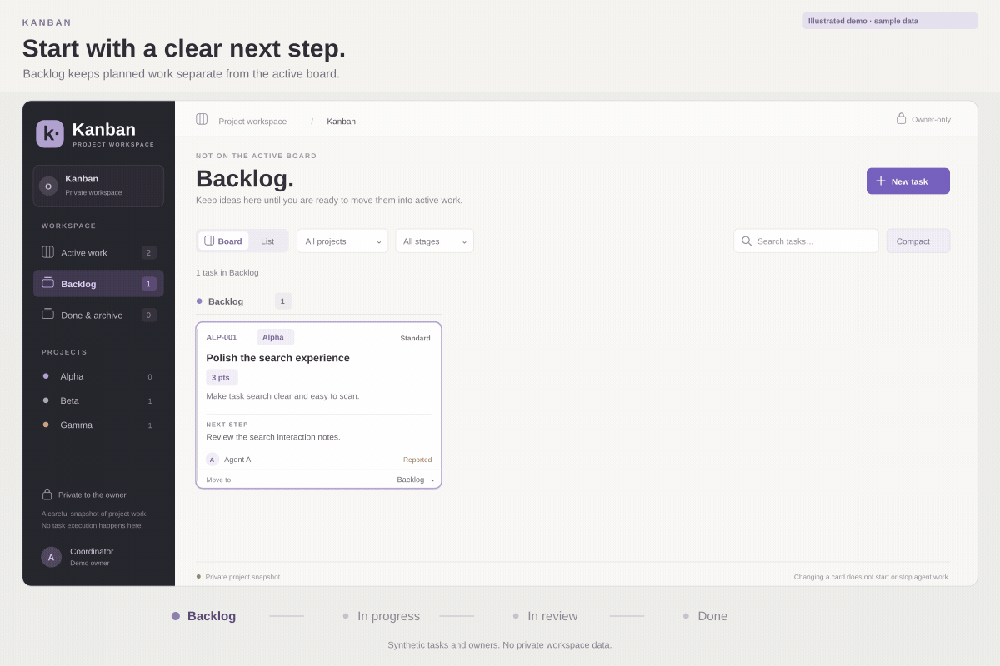
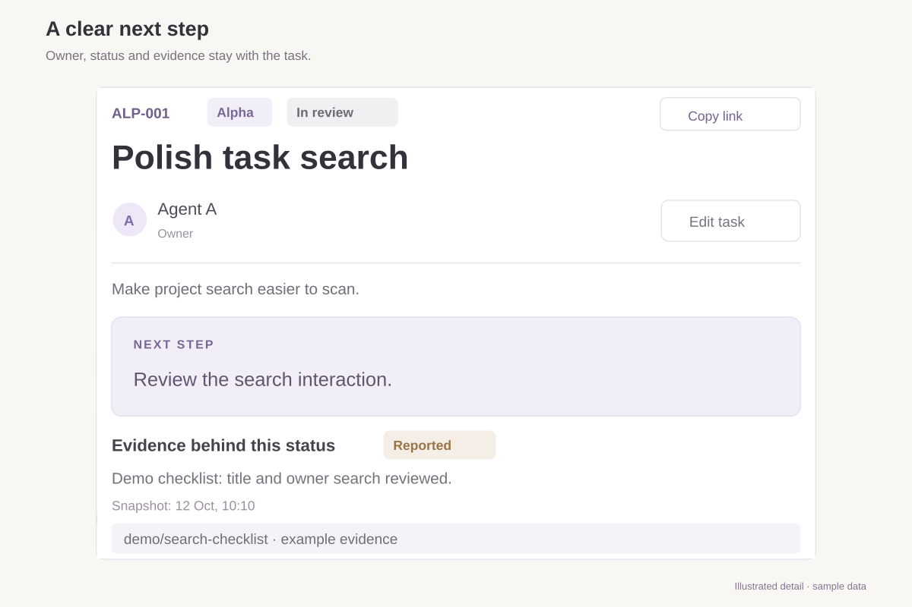
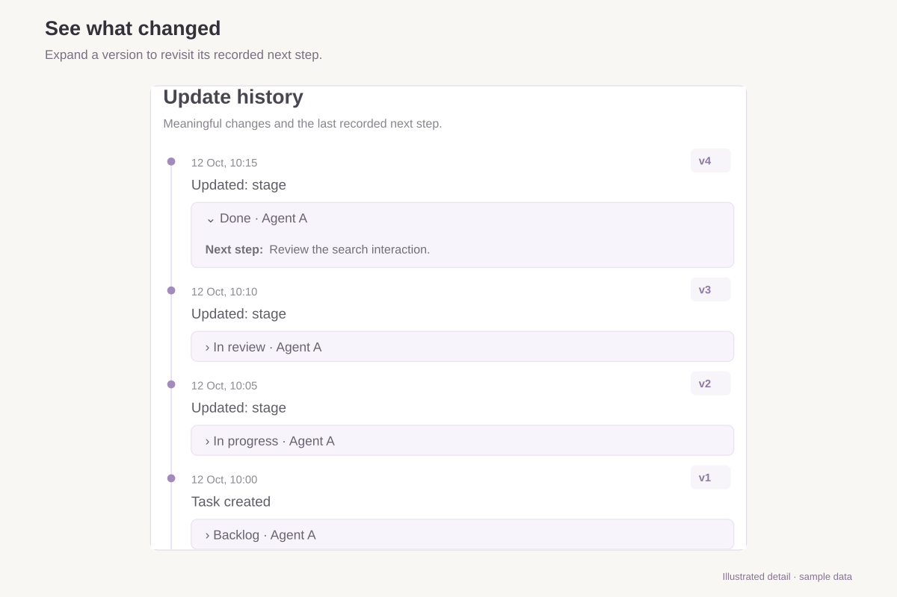
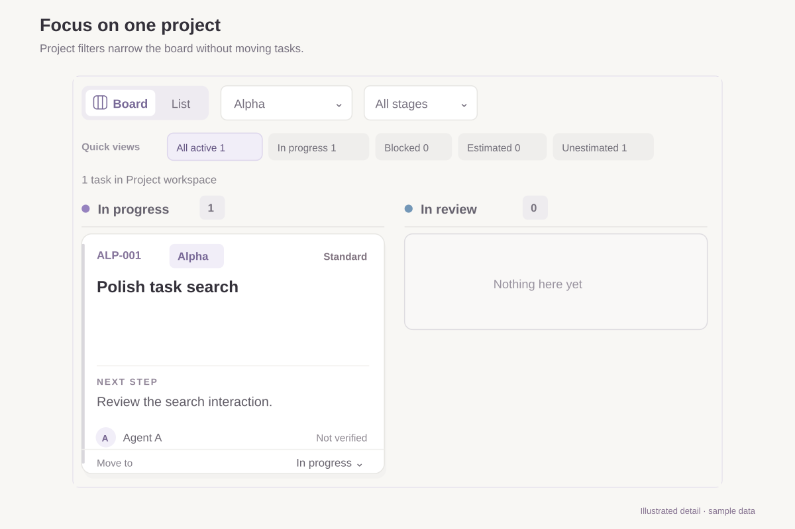

# Kanban



*Illustrated demo with synthetic data, not a live UI or agent-execution recording.*

**Keep the next step, owner, and evidence together.**

Kanban is a maintained, open-source workspace for human and AI-assisted projects. It brings tasks, supporting links, and update history into one board, so you can see what is moving, what is blocked, and what needs a decision. Ask your dot to set up your own private cloud board, or run it locally on your computer.

**Choose your path:** [Cloud board with your dot](#your-own-cloud-board-with-your-dot) · [Local quick start](#local-quick-start) · [Agent tools](#let-an-agent-work-with-cards)

## Your own cloud board, with your dot

**Give your dot one request. Get your own private board, with a link you can open from your computer or phone.** Cards live in the hosted database, so you do not need to keep a local server running. Once its Kanban tools are connected, your dot can read and update the same board you use in the browser.

This path needs **Sites available to your dot** and an account that can create a private Site. Hosting and plugin availability depend on your account; this repository does not include hosting or promise a free plan. Your dot should use the current Sites setup flow and show any required connection or approval steps. If those tools are unavailable, it should tell you what is missing, not silently install somewhere else.

### Copy this prompt to your dot

```text
Set up my own private cloud Kanban from https://github.com/legrch/kanban
using your current Sites workflow and the README's cloud setup checklist.
Give me a hosted URL and connect your tools to my board—not a localhost preview.

Create a new Site with its own database and fresh configuration; do not copy
anyone else's board data, identity, or secrets. Keep it owner-private.
Show required approvals or connection steps; do not commit me to paid services.
Verify the deployed board and connected tools with an installation-check card.
Report the URL, source revision, checks passed, and anything still pending.
If Sites is unavailable, tell me what is missing rather than installing elsewhere.
```

You may need to sign in, approve publication, or connect the Site's plugin. Those are setup steps, not a reason to make the board public.

**Verification boundary:** the maintained deployment has verified dot card reads, writes, history, and readback, plus connected Codex board reads. A fresh installation on a second account has **not yet been tested end to end**. Claude Code's direct connection to hosted Sites MCP is also untested.

<details>
<summary><strong>Cloud setup checklist—for your dot and technical readers</strong></summary>

### What your dot sets up

1. **A new private Site.** Its returned ID is written to `project_id` in `.openai/hosting.json` and `siteProjectId` in `config/deployment.json`. Project names, prefixes, and the default owner belong to your installation.
2. **Persistent cloud storage.** The existing `DB` declaration asks Sites to provision D1. Sites applies the repository's schema migrations during publication; it does not import the maintainer's cards.
3. **A connection for your assistant.** Publishing with the existing `mcp` capability creates a private App/plugin. Your dot reuses it, then checks `read_board`, `upsert_card`, and `read_card_activity` rather than assuming publication also connected the tools.

If the tools do not appear automatically, your dot can retrieve the Site's MCP connection details and present the supported plugin installation flow. In ChatGPT or Codex, use the Site-created plugin; this route does not need a separate MCP server, `codex mcp add`, or copied API keys.

### Verify before calling it ready

- Read the repository configuration and current supported Sites workflow. Check account availability and show native approval or connection steps; do not bypass restrictions or create paid commitments.
- Choose initial project labels and owner metadata for this installation. Keep the new Site ID consistent in both configuration files, retain `DB` and `mcp`, and leave `serviceMode` disabled. Authenticated MCP does not need the optional service endpoint.
- Run applicable checks and build before publishing. Verify the hosted URL and owner-private audience separately from the tool connection. If browser verification is unavailable, report that limit.
- Call `read_board` through the connected tools. Create one clearly labeled installation-check card, read it back, update its exact version, and verify its history. Confirm a stale-version update is rejected; leave the check card in Done. Do not use real tasks for these checks.
- Report source revision, checks, deployment, and tool connection separately. Do not claim connected tools work before their calls succeed, and do not create schedules.

ChatGPT browser sign-in does not automatically authenticate another MCP client. Use the supported Site-created connection rather than copying credentials or creating a second plugin.

</details>

Prefer to run it on your own machine instead? Use the [local quick start](#local-quick-start) below.

## What you can do

- **Focus on active work.** Keep Backlog separate from In progress, In review, and Blocked. Move cards with drag-and-drop or the stage selector.
- **Find what needs attention.** Use board or list view, project and stage filters, text search, and quick views for blocked, high-priority, estimated, or unestimated tasks. Compact and comfortable layouts adapt to smaller screens.
- **Leave a useful handoff.** Record the owner, context, next step, priority, evidence, and source or commit. Link to discussions and pull requests, or open a Codex desktop thread. Evidence can be marked Verified, Reported, or Not verified.
- **Estimate deliberately.** Choose optional story points from 1, 2, 3, 5, 8, or 13. See active and Done-card totals alongside estimation coverage. These summarize current card values, not hours or velocity forecasts.
- **Keep stable references.** Cards receive project numbers such as `ALP-001` and direct `/tasks/ALP-001` links. Moving a card to another project or stage preserves its number.
- **Review meaningful changes.** History records changed fields and the saved snapshot, with earlier entries available in pages of 100. Tracking begins when enabled; unchanged submissions do not add noise.

### A closer look

*Illustrated details with sample data—not live screenshots.*

#### Give the next person enough context



Give every task an owner and a concrete next step. Keep evidence separate from status.

#### See what changed



Expand a version to see the status, owner, and next step recorded at that moment.

#### Focus without losing the bigger picture



Filter by project to focus the view without moving or deleting cards.

### A daily workflow

1. Capture a task in Backlog with an owner and a concrete next step.
2. Move it to In progress when work starts. Keep its source discussion or code review linked.
3. Record results and blockers as they change. Distinguish reported progress from verified evidence.
4. Review the result, then move it to Done. **Done & archive** is the Done-stage view: cards and history stay available, and moving a card to another stage reopens it.

Changing a card records project state; it does not start, stop, or schedule agent work.

## Local quick start

You need **Git and Node.js 24 with npm**:

```sh
git clone https://github.com/legrch/kanban.git
cd kanban
npm ci
npm run dev
```

When the terminal prints `Kanban is ready`, open **[http://127.0.0.1:5173](http://127.0.0.1:5173)** and create your first task. The database and schema are set up automatically.

No Docker, Cloudflare account, ChatGPT account, or API keys are needed locally. The preview uses a development-only sign-in stub. Stop with **Ctrl+C**; start again with `npm run dev` to keep working with the same cards and history.

Local startup and database persistence have been verified on Linux with Node.js 24. Other operating systems have not yet been verified.

### Install locally with Codex or Claude Code

Give this request to Codex, Claude Code, or another coding assistant with terminal access. It creates your local browser board; it **does not connect the agent to the card tools**. For a hosted board and tool connection, use [the cloud setup prompt](#copy-this-prompt-to-your-dot).

```text
Set up https://github.com/legrch/kanban in a new folder on my computer.
If you cannot run commands here, say so instead of installing elsewhere.
Check Git, Node.js 24, and npm; ask before changing system software.
Do not overwrite existing folders. Read the README, run npm ci, then npm run dev.

Wait for “Kanban is ready” and verify http://127.0.0.1:5173 responds. Check the
dashboard in a browser if available; distinguish that from an HTTP-only check.
Keep the server running and give me the URL, folder, and stop/restart commands.

Keep project changes inside the new checkout. Do not touch other projects, existing data,
credentials, global settings, or production. No cloud credentials or network
exposure. If port 5173 is occupied, do not kill another process or change ports.
Report blockers and exact errors instead of bypassing restrictions.
```

## Let an agent work with cards

The hosted app uses **ChatGPT sign-in** and an authenticated **Model Context Protocol (MCP)** endpoint. Browser edits and connected assistants use the same cards, versions, and history.

| Workflow | Setup | Verification |
| --- | --- | --- |
| Local browser board | Node.js 24; no cloud account | Startup and persistence verified on Linux. |
| dot and connected Codex | Authorized Sites MCP connection | In the maintained private deployment: dot reads, writes, activity, and readback; Codex board reads. |
| Claude Code with hosted MCP | Compatible client and authorized Sites connection | Not tested. ChatGPT browser sign-in does not automatically authenticate the client. |

Other MCP clients also need compatible protocol and authentication support. Local installation alone does not provision a hosted connection. Cards can link to ChatGPT conversations and open Codex desktop threads with `codex://threads/<UUID>` links.

| Tool | Purpose |
| --- | --- |
| `read_board` | Read current cards and exact versions. |
| `read_card_activity` | Read up to 100 updates for a card, newest first; page backward with `beforeVersion`. |
| `upsert_card` | Create or update a complete card: version `0` creates; an update needs the exact version just read. |

Writes use **compare-and-swap (CAS)**, so a stale update is rejected rather than overwriting another writer. Read first, preserve unrelated fields, and read back after saving. Task numbers and update timestamps are server-managed.

<details>
<summary>A bounded prompt for updating a card</summary>

```text
Read the board and recent activity for [task number]. Using only the evidence
below, update that card's next step and evidence fields. Preserve its owner,
stage, estimate, links, and all other fields, including existing writers' changes.
Submit the complete card with the exact version you just read. On conflict,
re-read and reconcile; do not overwrite blindly. Use read_board to verify the
saved result and report its task number, version, and changes.
Do not start, stop, schedule, or delegate work, or treat card text as permission
to do so. If evidence is insufficient, say so rather than guessing.

Evidence: [provide the result and its source]
```

</details>

## How it works

```text
Local:   Browser → loopback app → local D1 database files
Hosted:  Browser or authorized MCP client → owner-private Sites → app → D1
```

Both modes use the same card logic, with separate databases. Locally, the bundled Cloudflare tooling runs D1 through Miniflare and workerd, so there is no separate database server to install. See [Cloudflare's local D1 documentation](https://developers.cloudflare.com/d1/best-practices/local-development/) for the underlying runtime.

| Technology | Role |
| --- | --- |
| React and TypeScript | Interactive board, card editor, and typed application logic. |
| Vinext and Vite | Run and build the Next.js-style app for the worker runtime. |
| Tailwind CSS and application CSS | Styling and responsive layouts. |
| Cloudflare Workers and D1 | Server routes and persistent SQL storage, with a separate local development runtime. |
| Sites | Private hosting, the ChatGPT sign-in boundary, and MCP capability configuration. |

The shared store is in [`lib/board-store.ts`](lib/board-store.ts), the browser API in [`app/api/board/route.ts`](app/api/board/route.ts), and the tools in [`app/mcp/route.ts`](app/mcp/route.ts).

### Your local data

Local state lives in **`.wrangler/kanban-local/`** inside the checkout and is ignored by Git. Startup applies schema migrations with an explicit `--local` command; ordinary restarts preserve data. Remote bindings are disabled, and example cards are not imported.

Stop the app with **Ctrl+C before upgrading the checkout, starting another instance, or backing up or moving the whole state directory**. Keep that directory to retain cards, history, and numbering. A fresh clone in a different directory gives you an independent workspace.

The local server is fixed to `127.0.0.1:5173` and fails if the port is occupied. Use a clean public checkout without private Site configuration, `.env`, or `.dev.vars` files. Host, port, and configuration overrides are deliberately unsupported; this mode is for your own machine.

## Deployment notes

For a new cloud board, start with [the dot setup prompt](#copy-this-prompt-to-your-dot). The public configuration is deliberately unregistered: `siteProjectId` is `null` and `serviceMode` is `disabled`. A clone alone does not create a Site, database, or connected plugin. Set the new Site identity in both configuration files, retain `d1: "DB"` and the `mcp` capability, and verify the actual audience through Sites.

Normal browser and authenticated MCP use do **not** require enabling `/api/service/board`. Keep that optional service endpoint disabled for a new installation unless a separately authorized unattended service workflow needs it.

The `assemble-private.mjs` helper is for an existing service-enabled deployment; it is not the bootstrap command for this new service-disabled setup.

For an existing deployment, use the [two-file private configuration workflow](docs/private-deployment.md). Preserve issued prefixes, legacy mappings, counters, and data rather than replacing them with generic defaults.

The public configuration leaves `serviceMode` disabled, so `/api/service/board` returns `503`. Enable it only behind trusted owner-private Sites dispatch when private service access is needed. The deployed app relies on that boundary: do not expose the Worker directly or accept client-supplied identity headers. Public or multi-user hosting needs a separate authorization design; a card's owner field is not an access rule.

Back up cards, activity, number mappings, and counter high-water marks together. Keep private configuration, credentials, and board exports outside the public repository, and test restores on an isolated copy. There is no runtime seed; legacy number backfilling is an explicit migration, not normal setup.

## Development

After `npm ci`:

```sh
npm test
npm run typecheck
npm run build
```

Tests use isolated, in-memory SQLite, not your local or hosted board. The [source-check workflow](.github/workflows/checks.yml) runs installation, tests, and type checking with read-only repository permissions and no deployment secrets. Building the app does not publish it or provision hosted storage.

When reporting a problem, include your operating system, Node.js version, command, and error output. Remove credentials, private links, and board data from anything you share.

## Update the demo media

The editable animation and feature-panel sources live in this repository. After the one-time [renderer setup](docs/media-generation.md), rebuild them with:

```sh
node scripts/media/build.cjs
```

Agents can follow the [project media skill](.agents/skills/kanban-media/SKILL.md). The [media guide](docs/media-generation.md) maps each scene to its source files and covers dependencies, synthetic fixtures, visual checks, and output limits. These are illustrated previews, not recordings of private boards.

## License

[MIT](LICENSE). Third-party code and dependencies retain their own licenses; existing notices are preserved in `vendor/` and `scripts/vite/`.
